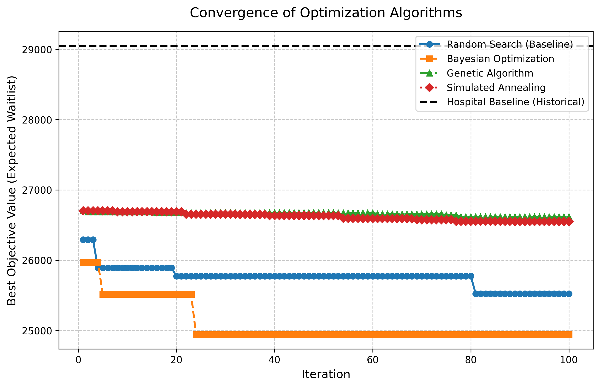
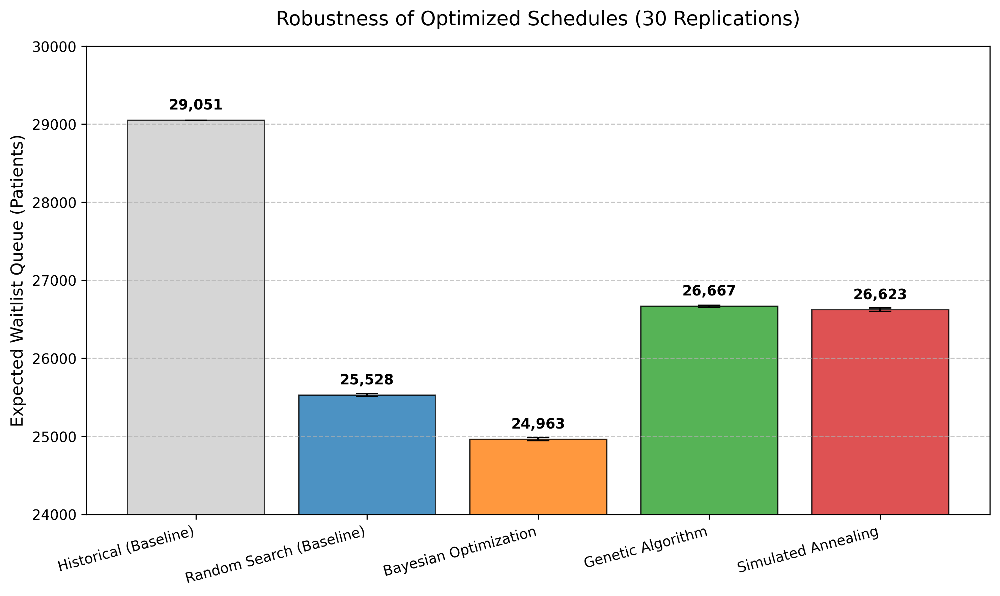

# Simulation-guided outpatient staff-hour allocation with Bayesian optimization

This repository contains the code and results accompanying the manuscript
*"Simulation-guided outpatient staff-hour allocation with Bayesian optimization"*.

The code implements a simulation-optimization pipeline that decides how many
monthly consultation hours each physician devotes to each specialty, activity
(Admissions or Checkups) and room, in order to minimize the expected
end-of-horizon outpatient waitlist. It combines:

1. **A feasible scheduler** — a mixed-integer linear program (Gurobi) that
   generates implementable schedules satisfying physician contract caps, room
   capacity, a maximum Admissions share, and per-specialty hour budgets.
2. **A stochastic monthly queue model** — a discrete-time, macroscopic
   queue-balance recursion with patient no-shows, physician absences, uncertain
   discharges, and a reduced-form referral inflow.
3. **Bayesian optimization** — a Gaussian-process surrogate (Matérn-5/2 + white
   noise) with Expected Improvement, learned on a 30-dimensional aggregation
   (Admissions and Checkups hours per specialty) of the 1,760 integer
   scheduling variables.

The method is benchmarked against random search, a genetic algorithm, and
simulated annealing on a 15-specialty case study from *CRS Hospital Provincia
Cordillera*, part of the South-East Metropolitan Health Service (SEMHS) in
Santiago, Chile.

## Main results

100-iteration benchmark, with all methods starting from the same 500 feasible
schedules. Every candidate evaluation averages three stochastic replications of
the 10-month queue model; the best schedule of each method is then re-evaluated
over 30 fresh replications (waitlist in patients; lower is better).

| Method                | Best found | Robust mean (30 rep.) | 95% CI               | Improvement vs. historical | Candidate evaluations | Time (s) |
|-----------------------|-----------:|----------------------:|----------------------|---------------------------:|----------------------:|---------:|
| Historical schedule   | —          | 29,050.63             | —                    | —                          | —                     | —        |
| Bayesian optimization | 24,941.67  | 24,962.97             | [24,944.97, 24,980.97] | 14.1%                    | 100                   | 1,150.98 |
| Random search         | 25,523.00  | 25,527.80             | [25,508.28, 25,547.32] | 12.1%                    | 100                   | 936.86   |
| Genetic algorithm     | 26,618.33  | 26,667.07             | [26,653.04, 26,681.09] | 8.2%                     | 2,000                 | 63.73    |
| Simulated annealing   | 26,548.33  | 26,622.93             | [26,603.20, 26,642.67] | 8.4%                     | 500                   | 17.64    |

These values are read directly from [`results/benchmark_results.csv`](results/benchmark_results.csv)
and correspond to the benchmark table of the manuscript. Run times include
feasible-pool generation and surrogate fitting; Bayesian optimization is the
slowest in wall-clock time because it generates and scores a 1,000-schedule
feasible pool and refits the Gaussian process at every iteration.

<p align="center">
  
  
</p>

## Repository structure

```
.
├── core/
│   ├── problem.py          # Case-study data and model parameters (HospitalProblem)
│   ├── gurobi_space.py     # Feasible scheduler: solution-pool sampling and L1 repair MILP
│   ├── simulator.py        # Stochastic monthly queue model and objective function
│   └── baseline.py         # Historical (baseline) schedule
├── optimizers/
│   ├── base_optimizer.py
│   ├── bayesian_optimizer.py   # GP surrogate + Expected Improvement
│   ├── random_optimizer.py     # Random search
│   ├── genetic_optimizer.py    # Genetic algorithm
│   └── sa_optimizer.py         # Simulated annealing
├── benchmark.py                # Runs the full-case benchmark (all four methods)
├── simulate_baseline.py        # Evaluates the historical schedule (no Gurobi needed)
├── kernel_analysis.py          # Online kernel-sensitivity analysis of the GP surrogate
├── plot_results.py             # Convergence plot and summary table
├── plot_robustness.py          # 30-replication robustness plot
├── plot_kernel_sensitivity.py  # Kernel-sensitivity bar chart
└── results/                    # Results and figures reported in the manuscript
```

## Mapping between the manuscript and the code

| Manuscript                                       | Code |
|--------------------------------------------------|------|
| Case-study inputs (specialty, routing and demand tables) | `core/problem.py` |
| Feasible scheduler module and its appendix formulation  | `core/gurobi_space.py` (`_add_hospital_constraints`, `sample_feasible_space`) |
| Simulation module (monthly queue recursion)      | `core/simulator.py` (`simulate_specialty_waitlist`) |
| Objective: mean of 3 replications; final assessment: 30 replications with Student-t 95% CI | `core/simulator.py` (`simulator_objective`, `evaluate_solution_robust`) |
| Bayesian optimization module (Algorithm 1)       | `optimizers/bayesian_optimizer.py` |
| ℓ1 repair MILP used by GA and SA                 | `core/gurobi_space.py` (`repair_solution`) |
| Full-case benchmark                              | `benchmark.py` → `results/benchmark_results.csv` |
| Kernel sensitivity                               | `kernel_analysis.py`, `plot_kernel_sensitivity.py` |

The parameters in `core/problem.py` use the index notation of the
feasible-schedule appendix: `i` physicians (44), `j` activities (2: 0 =
Admissions, 1 = Checkups), `k` rooms (20), and `s` specialties (15); `E[s]` is
the list of physicians of specialty `s`, `o` the room capacities, `c` the
physician contract caps, and `p` the maximum Admissions share. Optimizers
maximize the objective, which is the **negative** expected waitlist.

## Installation

Tested with Python 3.13 on macOS.

```bash
python3 -m venv .venv
source .venv/bin/activate
pip install -r requirements.txt
```

### Gurobi license

The feasible scheduler requires [Gurobi](https://www.gurobi.com/) and a valid
license. The sampling model has 1,760 integer variables, and the repair model
used by the genetic algorithm and simulated annealing adds 1,760 auxiliary
variables and 3,520 constraints, which exceeds the size-limited license bundled
with the `gurobipy` pip package. A full license (e.g., Gurobi's free academic
license) is therefore needed to run `benchmark.py` and `kernel_analysis.py`.
`simulate_baseline.py` and the plotting scripts do not require Gurobi.

## Usage

All scripts are run from the repository root.

**Evaluate the historical schedule** (queue model only):

```bash
python simulate_baseline.py
```

**Run the full benchmark** (500 initial schedules, 100 iterations per method, as in the manuscript):

```bash
python benchmark.py
```

This writes `results/benchmark_results.csv` (and overwrites the file shipped
with the repository). Optional arguments: `--iterations`, `--initial-samples`,
`--seed`, `--output`, `--bo` (Bayesian optimization only), and `--baseline`
(adds the historical schedule to the initial sample; not used in the
manuscript). For a quick check of the installation:

```bash
python benchmark.py --iterations 1 --initial-samples 20 --output results/smoke_test.csv
```

**Regenerate the figures** from the CSV:

```bash
python plot_results.py
python plot_robustness.py
python plot_kernel_sensitivity.py
```

**Run the kernel-sensitivity analysis:**

```bash
python kernel_analysis.py
python plot_kernel_sensitivity.py --csv results/kernel_sensitivity_online.csv
```

### Output format

`results/benchmark_results.csv` contains one row per method and iteration:

| Column | Description |
|--------|-------------|
| `Optimizer` | Method name |
| `Iteration` | Iteration index (1–100) |
| `Best_Objective` | Best-so-far objective (negative 3-replication mean waitlist) |
| `ExecutionTime_Secs` | Total run time of the method |
| `Robust_Mean`, `Robust_CI_Lower`, `Robust_CI_Upper` | 30-replication assessment of the final best schedule (negative waitlist; last iteration only) |
| `Hospital_Baseline` | 30-replication mean waitlist of the historical schedule |

## Reproducibility notes

- Both NumPy's global random generator and Python's `random` module are seeded
  with the same value (`--seed`, default 42) when `HospitalProblem` is created.
  NumPy drives the random objective coefficients of the Gurobi solution pool,
  the draws from the pool, the stochastic queue model, and the restarts of the
  GP hyperparameter optimizer; Python's `random` drives the genetic-algorithm
  and simulated-annealing operators. With the same software versions and
  platform, repeated runs produce identical results.
- The seed for Python's `random` was added when preparing this repository,
  after the results in `results/benchmark_results.csv` were generated. Those
  genetic-algorithm and simulated-annealing trajectories therefore came from an
  unseeded generator, and a rerun will not reproduce them exactly. Gurobi's
  solution pool may also differ across Gurobi versions, platforms, and thread
  counts. A rerun of `benchmark.py` may therefore produce values that differ
  from those in `results/benchmark_results.csv`.
- The CSV contains a single benchmark trajectory per method.
- The kernel-sensitivity values plotted by default in `plot_kernel_sensitivity.py`
  are the recorded results reported in the manuscript. `kernel_analysis.py`
  evaluates the kernels with scikit-learn's default hyperparameter
  initializations (e.g., Matérn with ν = 1.5) and two optimizer restarts,
  whereas the optimizer uses Matérn (ν = 2.5) + white noise, `alpha = 1e-2`, and
  ten restarts.

## Scope of the implementation

The following points are also stated in the manuscript and are listed here for
clarity:

- **Forecast module.** The optimization code does not fit forecasting models.
  It uses the fixed weekly external-arrival rates of the case-study demand
  table. The data-cleaning, arrival-rate calibration, and forecasting workflows
  described in the manuscript are not part of this repository.
- **Routing.** The 15×15 routing matrix is stored in `core/problem.py` for
  reference and for the stability analysis, but it is not used by the queue
  model, which represents referrals through an independent reduced-form inflow
  per specialty.
- **Stability.** The queue-stability condition of the manuscript's proposition is
  not imposed as a constraint in the feasible scheduler.
- **Inactive constraints.** The minimum-activity-hours and activity–room
  incompatibility constraints are implemented but inactive in the full-case
  configuration.

## Data availability

The analysis is based on administrative records provided by the South-East
Metropolitan Health Service (SEMHS), which are not publicly available owing to
privacy and institutional restrictions. This repository contains only the
aggregated, specialty-level figures reported in the manuscript (initial queues,
observed hours, patients served, discharge probabilities, routing
probabilities, and weekly arrival rates), which are sufficient to run the
benchmark. No patient-level data are included.

## Authors

- Diego Machado — Departamento de Ingeniería Industrial, Universidad de Santiago de Chile
- Guido Lagos — Facultad de Ingeniería y Ciencias, Universidad Adolfo Ibáñez
- Francisco Jara-Moroni (corresponding author, francisco.jara@mail.udp.cl) — Facultad de Ingeniería y Ciencias, Universidad Diego Portales
- René Lagos — Facultad de Medicina, Universidad de Chile
- Bastián Saavedra — Departamento de Ingeniería Industrial, Universidad de Santiago de Chile
- Tomás Torres — Departamento de Ingeniería Industrial, Universidad de Santiago de Chile

## Citation

If you use this code, please cite the accompanying manuscript (see also
[`CITATION.cff`](CITATION.cff)):

```bibtex
@unpublished{machado_simulation_guided_staff_hour_allocation,
  title  = {Simulation-guided outpatient staff-hour allocation with Bayesian optimization},
  author = {Machado, Diego and Lagos, Guido and Jara-Moroni, Francisco and Lagos, Ren{\'e} and Saavedra, Basti{\'a}n and Torres, Tom{\'a}s},
  note   = {Manuscript submitted for publication}
}
```

## License

This project is released under the MIT License. See [`LICENSE`](LICENSE).
